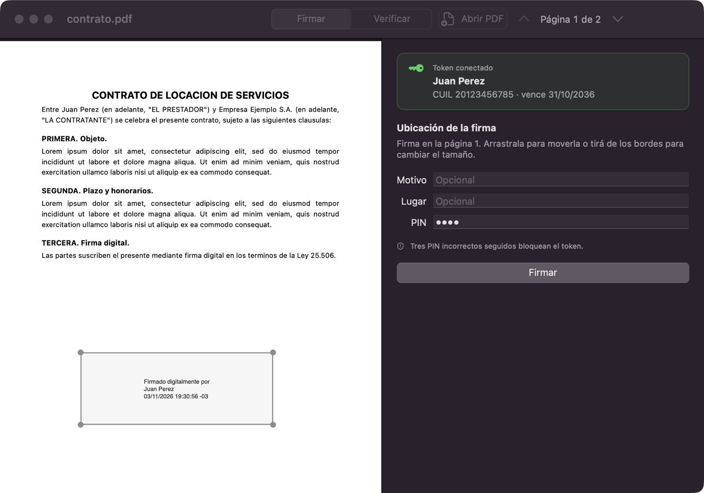
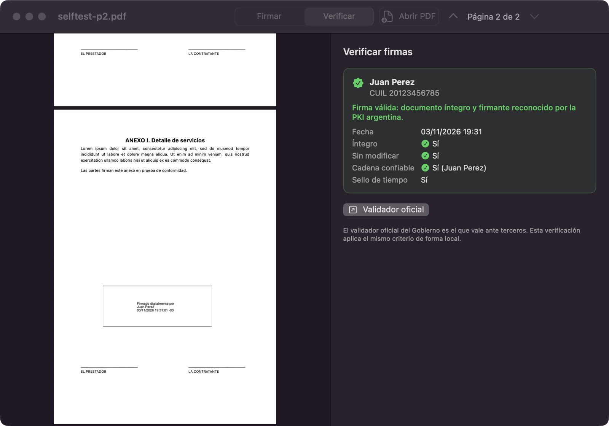
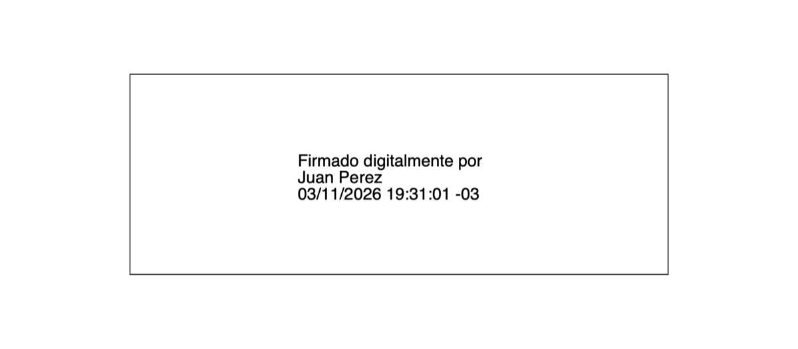
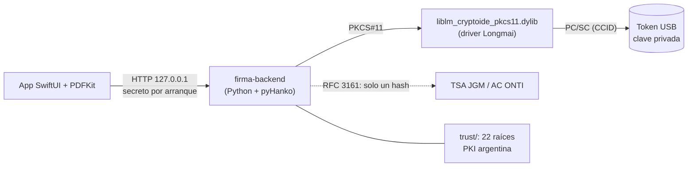

# Firma Digital para macOS

App nativa de macOS para firmar y verificar PDFs con firma digital argentina (Ley 25.506) usando un token USB
como el mToken CryptoID.

[](LICENSE)
[](https://github.com/clubpet/firma-digital-mac/releases/latest)
[](https://github.com/clubpet/firma-digital-mac/actions/workflows/ci.yml)
[](https://github.com/clubpet/firma-digital-mac/actions/workflows/release.yml)

<p align="center">
  
  
</p>
<p align="center">
  
</p>

<sub>Capturas hechas con un token de prueba (SoftHSM) a nombre de "Juan Perez" y una raíz de prueba; no son datos reales.</sub>

## Qué hace

- **Firmar:** abrís un PDF, dibujás el recuadro de la firma sobre la página, ponés el PIN y listo. Sale un PDF
  con firma **PAdES-B-T**: firma visible + sello de tiempo RFC 3161 de la TSA oficial (Jefatura de Gabinete /
  AC ONTI).
- **Verificar:** abrís un PDF firmado y ves quién firmó (nombre y CUIL), cuándo, si el documento fue
  modificado después y si el certificado viene de la PKI argentina. Usa los mismos criterios que el
  [validador oficial](https://validadordefirmas.gob.ar).
- **Sin instalar nada más:** el DMG trae el driver del token, el motor de firma y los 22 certificados raíz
  oficiales.
- Todo pasa en tu Mac. No hay cuentas, servidores propios ni telemetría.

## Por qué existe

Con mi hermano compramos un token **mToken CryptoID FIPS 140-3** (fabricado por Longmai, vendido en Argentina
por Macroseguridad) para tener firma digital con certificado de AC ONTI. La Autoridad de Registro nos cargó
el certificado y nos fuimos con el token y... drivers solo para Windows (un instalador detrás de un portal de
tickets) y una guía oficial para firmar con Windows + Adobe Reader. Nosotros usamos Mac.

Investigando encontramos que **sí existe un middleware oficial para macOS**: un `.pkg` de Longmai firmado con
Developer ID y notarizado por Apple, que Macroseguridad entrega solo por ticket pero que el
[Colegio de Escribanos de la Provincia de Buenos Aires publica](https://www.colescba.org.ar/static/descarga/fima-digital/2026/MSCryptoID-FIPS140-3_Mac_Spanish_V2.0.25.0912%201.zip).
Instala una librería PKCS#11 (`liblm_cryptoide_pkcs11.dylib`) que habla con el token por PC/SC; el token es
un dispositivo USB CCID, así que macOS no necesita driver USB. (OpenSC no soporta tokens Longmai.)

Con eso cargado, Adobe Reader en Mac firma, pero es engorroso, y como la raíz argentina no está en la lista
de confianza de Adobe (AATL), cualquier firma se ve con "validez desconocida" hasta importar las raíces a
mano. Así que hicimos esto: una app chica, en castellano, que hace solo dos cosas y las hace bien.

Probado de verdad: un PDF firmado con la app da **"Documento Válido"** con sello de tiempo en
validadordefirmas.gob.ar.

## Instalación para usuarios

Requisitos: Mac con **Apple Silicon** (M1 o posterior) y **macOS 14** o posterior.

1. Bajá el último `Firma Digital-<versión>.dmg` de [Releases](https://github.com/clubpet/firma-digital-mac/releases/latest).
2. Abrilo y arrastrá **Firma Digital** a **Aplicaciones**.
3. Enchufá el token y abrí la app.

**Primera apertura.** La app todavía no está firmada con Developer ID ni notarizada (está firmada ad-hoc),
así que macOS la bloquea la primera vez:

- **macOS 14 (Sonoma):** clic derecho (o Control + clic) sobre la app en Aplicaciones → **Abrir** → **Abrir**.
- **macOS 15 (Sequoia) y 26 (Tahoe):** abrila con doble clic y tocá **Listo** en el aviso. Después andá a
  **Configuración del Sistema → Privacidad y seguridad**, bajá hasta "Se bloqueó Firma Digital" y tocá
  **Abrir igual** (confirmás con contraseña o Touch ID).
- Si nada de eso funciona: `xattr -dr com.apple.quarantine "/Applications/Firma Digital.app"` en Terminal.

Se hace una sola vez. Podés comparar el sha256 del DMG con el que figura en la release.

## Uso

**Firmar**

1. Abrí un PDF (botón **Abrir PDF**, Cmd+O, arrastrándolo a la ventana o con "Abrir con" desde Finder).
2. Hacé clic o arrastrá sobre la página para marcar dónde va la firma. El recuadro se puede mover y
   cambiar de tamaño.
3. Opcional: motivo y lugar. Escribí el PIN y tocá **Firmar**.
4. Elegí dónde guardar `<nombre>-firmado.pdf`. El original no se toca.

Un PDF ya firmado se puede volver a firmar (por ejemplo, la segunda parte de un contrato): cada firma se agrega
como revisión incremental y no invalida las anteriores.

**Verificar**

Pasá a la pestaña **Verificar** con un PDF abierto. Por cada firma muestra firmante, CUIL, fecha, si el
documento está íntegro, si se modificó después de firmar, si la cadena de confianza llega a una raíz oficial
y si tiene sello de tiempo.

**Validador oficial**

El veredicto que vale ante terceros es el de https://validadordefirmas.gob.ar (el botón **Validador oficial**
lo abre). La verificación de la app aplica el mismo criterio, pero en local y sin subir el documento.

## Cómo funciona



- **App** (`app/`): SwiftUI + PDFKit. Muestra el PDF, convierte el recuadro que dibujás a coordenadas de la
  página y le habla al motor por HTTP en `127.0.0.1`, con un secreto aleatorio que genera en cada arranque.
- **Motor** (`firma.py`, congelado con PyInstaller como `firma-backend`, viaja dentro de la app): firma con
  [pyHanko](https://github.com/MatthiasValvekens/pyHanko). La clave privada nunca sale del token: el motor le
  pasa el hash al token por PKCS#11 y el token devuelve la firma.
- **Driver:** la librería PKCS#11 oficial de Longmai. No está en el repo: `app/fetch-driver.sh` la baja en el
  build y verifica su sha256.
- **Raíces de confianza** (`trust/`): los 22 certificados oficiales de la PKI argentina, idénticos a los que
  publica la JGM (huellas en [trust/README.md](trust/README.md)). La verificación evalúa la cadena a la fecha
  de firma declarada, acepta SHA-1 y trata la revocación como soft-fail, igual que el validador oficial.
- **Sello de tiempo:** cada firma pide un sello RFC 3161 a `https://tsa.encodesa.com.ar/tsa` (los sellos los
  firma el "Servicio de Sellado de Tiempo de JGM", emitido por AC ONTI). Si no hay conexión, firma igual sin
  sello (PAdES-B-B) y te avisa.

## Compilar desde el código

Requisitos: Apple Silicon, macOS 14+, **Xcode 26+**, **Python 3.12**, y para los tests
`brew install softhsm opensc`.

```sh
python3.12 -m venv .venv
sh build-backend.sh                                 # instala requirements.txt y congela el motor -> dist/firma-backend/
sh app/build-app.sh                                 # baja el driver, compila la app -> app/build/Firma Digital.app
sh packaging/make-dmg.sh "app/build/Firma Digital.app"   # -> packaging/dist/Firma Digital-<versión>.dmg + sha256
sh packaging/verify-dmg.sh "packaging/dist/Firma Digital-<versión>.dmg"
```

`BUILD_DIR=app/build-dev sh app/build-app.sh` compila en otra carpeta (para no pisar una app abierta). Firma
Developer ID y notarización: [packaging/README.md](packaging/README.md). La versión sale del archivo
`VERSION`; las releases se publican con un tag `v<VERSION>`.

**Tests** (sin token real, contra SoftHSM):

```sh
sh dev/softhsm-setup.sh                                                          # token "FirmaDev", PIN 1234
.venv/bin/python test_firma.py                                                   # firma.py
FIRMA_BACKEND=dist/firma-backend/firma-backend .venv/bin/python test_firma.py    # binario congelado
```

`test_firma.py` arma su propio token SoftHSM con dos certificados y una TSA local, y prueba firma B-T, PIN
incorrecto, páginas rotadas y recortadas, verificación, alteración de un byte, `--lt` y TSA caída.

**Selftest de la app** (abre la ventana y simula el mouse sobre el PDF sin mover el del sistema; solo con
SoftHSM):

```sh
SOFTHSM2_CONF=$PWD/dev/softhsm2.conf FIRMA_PKCS11_LIB=/opt/homebrew/lib/softhsm/libsofthsm2.so \
FIRMA_SELFTEST=/ruta/prueba.pdf FIRMA_SELFTEST_PIN=1234 FIRMA_SELFTEST_OUT=/tmp/selftest \
  "app/build/Firma Digital.app/Contents/MacOS/FirmaDigital"
```

Variables útiles al lanzar la app desde Terminal: `FIRMA_BACKEND` (otro motor, por ejemplo `$PWD/firma.py`),
`FIRMA_PKCS11_LIB` (otro driver), `FIRMA_TRUST_DIR` (otras raíces), `FIRMA_TSA` (otra TSA o `none`).

## API del backend

Contrato estable entre la app y el motor. Los errores de `/sign` son texto plano en castellano; los del resto,
JSON `{"error": "..."}`.

**CLI**

```
firma-backend [--port N] [--host 127.0.0.1] [--lib RUTA] [--trust DIR] [--token SECRETO] [--lt] [--tsa URL|none] [-v]
```

- Al arrancar imprime por stdout una sola línea `READY port=<n>` (los logs van a stderr). `--port 0` = puerto
  libre al azar.
- `FIRMA_PKCS11_LIB`, `FIRMA_TRUST_DIR`, `FIRMA_LT=1` y `FIRMA_TSA` son los defaults de `--lib`, `--trust`,
  `--lt` y `--tsa`. TSA por defecto: `https://tsa.encodesa.com.ar/tsa`.
- Sin `--lib` busca el driver en `~/Library/CryptoIDE/lib/`, `/opt/CryptoIDE/lib/` y SoftHSM de Homebrew.
- Con `--token`, todo request sin el header `X-Firma-Token: <secreto>` recibe `401`.
- Sin `--lt` el motor queda ocioso al arrancar (no descarga nada).

**Endpoints**

| Método y ruta | Qué hace |
|---|---|
| `GET /health` | `{"ok": true, "version": "..."}` |
| `GET /status` | driver, raíces, tokens conectados y sus certificados (nunca el PIN) |
| `POST /sign` | firma un PDF y devuelve los bytes del PDF firmado |
| `POST /verify` | verifica todas las firmas de un PDF |
| `GET` o `POST /shutdown` | `{"ok": true}` y el proceso termina con código 0 |

**`GET /status`** → `{"lib", "lib_found", "trust_roots", "lt", "tsa" (URL o null), "tokens": [{"slot", "label",
"serial", "pin_status", "certs": [{"label", "id", "cn", "subject", "valid_until"}]}]}`, más `"error"` si algo
falla y `"pkcs11_error"` si la librería existe pero no carga o el token falla. `pin_status`: `ok` | `bajo`
(hubo intentos fallidos desde el último correcto) | `ultimo_intento` | `bloqueado`.

**`POST /sign`** (multipart)

| Campo | Descripción |
|---|---|
| `pdf` | el archivo |
| `pin` | PIN del token; se usa solo en esa petición |
| `page` | página, desde 1 (default 1) |
| `x`, `y`, `w`, `h` | recuadro en puntos, admiten decimales (default 50/50/220/60) |
| `reason`, `location` | motivo y lugar (opcionales) |
| `cert_id` | id hex del certificado (de `/status`); sin él, el primero del token |

- **Coordenadas:** espacio de usuario de la página sin rotar, origen abajo a la izquierda; es el mismo
  espacio que el "page space" de PDFKit (`PDFView.convert(_:to:)`, `PDFAnnotation.bounds`) y se usa tal cual
  como `/Rect`. Con `/CropBox` distinto del `/MediaBox` las coordenadas son absolutas (no restar el origen del
  CropBox) y la caja tiene que caer dentro del CropBox o es `400`. Con `/Rotate` 90/180/270 el `/Rect` sigue
  sin rotar (en una página a 90°, una caja ancha en pantalla tiene `w` chico y `h` grande, que es lo que
  devuelve PDFKit); el motor contrarrota la apariencia para que el texto se lea derecho.
- **`200`:** bytes del PDF, con headers `X-Filename` y `X-Signer` (URL-encoded) y `X-Level` (comparar por
  prefijo): `PAdES-B-T` (default); `PAdES-B-B` (`--tsa none`); `PAdES-B-B (sin sello de tiempo: <motivo>)`
  (TSA caída, la firma vale igual). Con `--lt`: `PAdES-B-LT`, o `PAdES-B-B (sin raices de confianza)` /
  `PAdES-B-B (sin CRL/OCSP: sin conexion o cadena no confiable)`, seguido de ` con sello de tiempo` si lo hubo.
- **Errores:** `400` datos inválidos (falta PDF o PIN, página inexistente, caja fuera de la página, `cert_id`
  no hex); `401` falta `X-Firma-Token`; `403` PIN incorrecto o de largo inválido; `404` no hay certificado con
  ese `cert_id`; `409` token no conectado, sin certificados, driver no encontrado o error del token; `423` PIN
  bloqueado. En `403`/`423` puede venir `X-Pin-Attempts-Left`: `bajo`, `1` (el próximo error bloquea) o `0`.

**`POST /verify`** (multipart `pdf`) → `{"firmas": [...], "raices_confianza": n}`. Cada firma es
`{campo, firmante, serial_number, emisor, fecha_firma, integra, sin_modificar, cobertura, modificaciones,
cadena_confiable, motivo_confianza, sello_de_tiempo, sello_de_tiempo_confiable, sello_de_tiempo_fecha (ISO,
hora de la TSA), sello_de_tiempo_emisor (CN de la TSA), validado_a, resumen}` o `{campo, error}`.
`serial_number` es el `serialNumber` del sujeto: en certificados argentinos, `CUIL 20xxxxxxxx5`.

**PAdES-B-LT:** con `--lt` se embeben CRL/OCSP de la cadena. La CRL de AC ONTI pesa ~9 MB: un PDF de 50 KB
pasa a ~9,3 MB, por eso está apagado por defecto. Sin red o con cadena no confiable firma igual en B-B y
`X-Level` lo dice. Para que una TSA extranjera figure como confiable, poné su raíz en `trust/tsa/*.pem` (solo
se usa para sellos de tiempo).

**Backend congelado:** `sh build-backend.sh` genera `dist/firma-backend/` (onedir, arm64, ~48 MB). Es onedir a
propósito: onefile (`ONEFILE=1`) se descomprime en cada arranque y tarda ~16 s; onedir arranca en ~0,3 s.

## Modo web (firma.py)

La versión original, para quien prefiere el navegador o quiere usar otro token:

```sh
python3.12 -m venv .venv && .venv/bin/pip install -r requirements.txt
.venv/bin/python firma.py                       # busca el driver solo; si no, --lib o FIRMA_PKCS11_LIB
```

Abrí http://127.0.0.1:8780, subí el PDF, elegí la posición en la vista previa y poné el PIN. Para probar sin
token: `sh dev/softhsm-setup.sh` y

```sh
SOFTHSM2_CONF=$PWD/dev/softhsm2.conf FIRMA_PKCS11_LIB=/opt/homebrew/lib/softhsm/libsofthsm2.so .venv/bin/python firma.py
```

Necesita el driver instalado en el sistema: el `.pkg` oficial (instala en `/opt/CryptoIDE/lib/`) o, sin sudo,
copiar solo la dylib a `~/Library/CryptoIDE/lib/`. Chequeo rápido:
`pkcs11-tool --module ~/Library/CryptoIDE/lib/liblm_cryptoide_pkcs11.dylib -L`. La UI web no manda
`X-Firma-Token`: con `--token` solo sirve la API.

`python3 validador_oficial.py doc.pdf` sube el PDF a validadordefirmas.gob.ar y devuelve su respuesta JSON
(integridad, AC licenciada, vencimientos, revocación, sello de tiempo).

## Preguntas frecuentes

PIN de fábrica, token bloqueado, "validez desconocida" en Adobe, validez legal y más: [docs/FAQ.md](docs/FAQ.md).

## Limitaciones conocidas

- Solo **Apple Silicon** y **macOS 14+**: el motor está compilado para arm64; no hay build para Intel.
- El DMG está **firmado ad-hoc** (sin Developer ID): la primera apertura requiere los pasos de arriba.
- **Tres PIN incorrectos bloquean el token.** Es el hardware: no hay arreglo por software (hace falta el PUK o
  que el proveedor lo reformatee). El PIN de fábrica es `12345678` salvo que la Autoridad de Registro lo haya
  cambiado.
- En páginas con CropBox desplazado, Vista Previa (PDFKit) puede mostrar el recuadro de la firma en blanco. La
  firma es válida y Acrobat la muestra bien.
- El sello visible es texto (nombre y fecha), sin imagen ni logo.
- Sin PAdES-B-LTA (sello de archivo a largo plazo). B-LT es opcional (`--lt`, solo modo web/API).
- Un token a la vez. Probado con mToken CryptoID FIPS 140-3; otros tokens PKCS#11, sin probar.

## Seguridad y privacidad

- El **PIN** se usa solo para la operación de firma: no se guarda, no se loguea y no sale de tu Mac.
- La clave privada nunca sale del token.
- El motor escucha solo en `127.0.0.1` y rechaza cualquier pedido sin el secreto que la app genera en cada
  arranque.
- Lo único que sale a internet: el pedido de **sello de tiempo** (contiene un hash, no el documento) y, al
  verificar o firmar con `--lt`, la descarga de listas de revocación públicas.
- **Sin telemetría**, sin cuentas, sin analytics.
- El modo web (`firma.py`) además hace que el navegador cargue pdf.js desde cdnjs para la vista previa
  (la librería, no tu PDF). La app nativa no lo usa.
- Para reportar una vulnerabilidad: [SECURITY.md](SECURITY.md).

## Marco legal

- [Ley 25.506 de Firma Digital](https://www.argentina.gob.ar/normativa/nacional/ley-25506-70749) y su
  reglamentación: la firma digital con certificado de un certificador licenciado tiene la misma validez que
  la firma manuscrita.
- Formato **PAdES** (ETSI EN 319 142), el estándar de firmas en PDF que usan Adobe y el validador oficial.
- Verificación de referencia: [validadordefirmas.gob.ar](https://validadordefirmas.gob.ar).

Este proyecto es software libre sin garantías y no está afiliado a la Jefatura de Gabinete, a AC ONTI, a
Macroseguridad ni a Longmai. La validez de cada firma depende de tu certificado; ante la duda, el validador
oficial manda.

## Créditos y licencias

- Código de este repositorio: [MIT](LICENSE), © 2026 Julian Rubino / ClubPet.
- [pyHanko](https://github.com/MatthiasValvekens/pyHanko) (MIT), de Matthias Valvekens, hace todo el
  trabajo pesado de PAdES.
- Driver del token: propietario de Longmai / Macroseguridad. No está en el repo; se descarga en el build
  con sha256 fijado y el DMG lo incluye sin modificar.
- PDFKit, SwiftUI y AppKit, de Apple.
- Detalle completo de terceros: [NOTICE.md](NOTICE.md).

## Contribuir

Issues y PRs bienvenidos: [CONTRIBUTING.md](CONTRIBUTING.md). Código de conducta:
[CODE_OF_CONDUCT.md](CODE_OF_CONDUCT.md). Si tenés otro modelo de token y lo probás, contanos.

## English summary

**Firma Digital para macOS** is a native macOS app (SwiftUI + PDFKit) to sign and verify PDFs with Argentine
digital signatures (Law 25.506) using a USB PKCS#11 token such as the Longmai mToken CryptoID FIPS 140-3. Open a
PDF, draw the signature box, type your PIN, and get a **PAdES-B-T** signed PDF (visible stamp plus an RFC 3161
timestamp from the official JGM / AC ONTI TSA). The verifier checks signatures against the 22 official
Argentine PKI roots with the same rules as the government validator (validadordefirmas.gob.ar).

The signing engine is Python ([pyHanko](https://github.com/MatthiasValvekens/pyHanko)) frozen with PyInstaller
and bundled in the app; the app talks to it over localhost with a per-launch secret. The vendor's proprietary
PKCS#11 driver is not in this repo: it is downloaded at build time with a pinned sha256 and shipped unmodified
in the DMG. Requires Apple Silicon and macOS 14+. The DMG is ad-hoc signed (not notarized yet). Nothing leaves
your Mac except the timestamp request (a hash) and public CRL downloads; no telemetry. MIT licensed.
